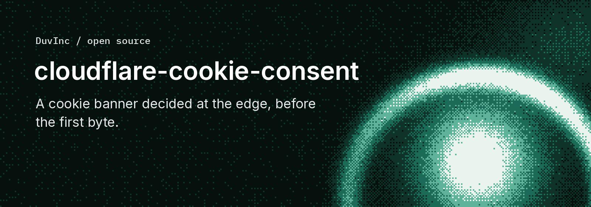
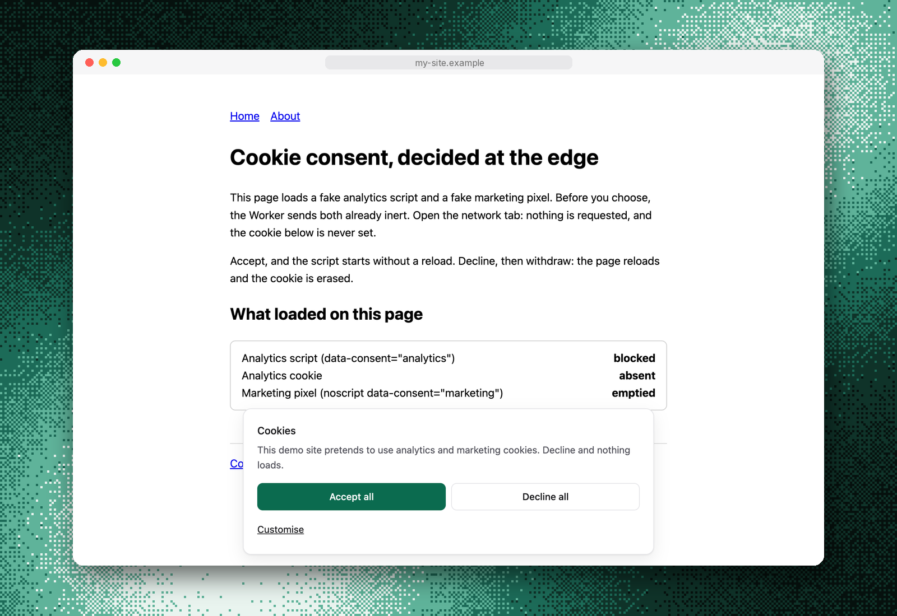

# cloudflare-cookie-consent

**Your cookie banner asks, but your trackers have already run. This one decides
before the first byte: the HTML arrives with every tag you have not been allowed
to load already inert.**



A consent management platform is a script. It loads after the page starts
parsing, so it either races your trackers (and loses, for the ones in the
`<head>`) or holds them back with a client-side patch that every tag manager and
every new snippet has to cooperate with.

This is a Cloudflare Worker that does it on the way out instead. The consent
cookie is first-party, so it is on the request. The Worker reads it, and rewrites
the HTML stream before anything reaches the browser: a tag without consent leaves
as `type="text/plain"`, which the browser does not run and the preload scanner
does not fetch. No CMP script. No flash of tracking. No dependency.

```ts
import { createConsent } from 'cloudflare-cookie-consent'; // or the copy of src/ in your repo

const consent = createConsent({
  site: 'my-site',
  vendors: [{ match: 'analytics.example.com', category: 'analytics' }],
  cookies: { analytics: ['_my_analytics_id'] },
});

// in your Worker's fetch():
//   POST /api/consent, GET /api/consent/banner      -> consent.handleConsentApi(request, env)
//   a page:  const asset = await env.ASSETS.fetch(consent.pageRequest(request));
//            return consent.applyConsent(request, asset);   // tags without consent are already inert
```

```html
<script data-consent="analytics">/* your analytics snippet */</script>
<noscript data-consent="marketing"></noscript>
```

The engine is 1,289 lines of TypeScript with comments, no npm dependency, and the
script it adds to a page is **2.1 KB gzipped** (5.9 KB raw). A visitor who has not
chosen yet gets the banner on top: **3.8 KB gzipped for both**, in the document,
so it paints with the first frame and moves nothing.



## How it works

```text
  browser                          Worker                              asset layer
     |   GET /pricing                 |                                      |
     |   Cookie: __consent=1~...      |                                      |
     |------------------------------->|   pageRequest(): drop If-None-Match, |
     |                                |   If-Modified-Since                  |
     |                                |------------------------------------->|
     |                                |<-------------------------------------|  the static HTML
     |                                |                                      |
     |                                |   applyConsent(): HTMLRewriter, streaming
     |                                |     <script data-consent="analytics">  -> type="text/plain"
     |                                |           -> src parked in data-consent-src
     |                                |     <noscript data-consent="...">      -> emptied
     |                                |     + banner and a 2 KB runtime before </body>
     |<-------------------------------|   no ETag, private no-cache, Vary: Cookie
     |
     |  click "Accept"  POST /api/consent {granted:[...]}
     |------------------------------->|  one row in D1 (optional), Set-Cookie: __consent (HttpOnly)
     |<-------------------------------|
     |  the runtime swaps each inert script for a live copy. No reload.
     |  A withdrawal sweeps the cookies and reloads: the next document is inert again.
```

**The decision is made on the server, so the cookie can be HttpOnly.** No
third-party script can read the choice and none can forge one. A client-side CMP
cannot offer that, because its own script has to read the cookie.

**Neutralise, never delete.** A tagged script keeps its `src`, its attributes and
its body, with an unknown `type`. That is enough for the browser to skip it and
for the preload scanner to leave the URL alone, and it keeps everything the
runtime needs to bring it back in place on a "yes". Deleting the node would make
consent mean "reload the page".

**Three ways a tag can be recognised, in order of honesty:**

| Mechanism | What it covers | Catch |
| :--- | :--- | :--- |
| `data-consent="analytics"` on the tag | scripts, inline snippets, ``, `<iframe>`, `<noscript>` | you must edit the HTML |
| `vendors: [{ match, category }]` | any element with a `src` or `href` containing the match | inline snippets are invisible to it: the Worker does not run JavaScript |
| `scripts/check-consent.mjs` at build | a known third party **without** the attribute | only signatures you listed |

The attribute is the honest route: explicit and auditable. The vendor list is a
belt for a tag that arrives with a URL and was never marked. The build guard
exists because an unknown tool pasted as-is passes the build, passes the deploy,
and the banner keeps showing as if all were well.

**Untagged and from no known vendor means strictly necessary.** Defaulting the
other way breaks a site on its first deploy, and a consent tool that breaks the
site gets removed the same day.

**The cookie is a readable string**, on purpose, so you can read it in devtools:

```text
__consent=1~analytics,marketing~k3f9x2~1760000000
          ^  ^                  ^      ^
          |  |                  |      decision time (unix seconds)
          |  |                  reference shown to the visitor, also in the log
          |  categories granted besides essential
          policy version: bump it when a vendor is added, and everyone is asked again
```

**The proof log is optional, and one row per decision.** With a D1 binding named
`DB`, each decision writes one row: site, time, policy version, categories,
country, locale, and a salted, truncated hash of the User-Agent. No IP. A visitor
who comes back ten times writes nothing. Without the binding, decisions are still
honoured and the Worker logs `consent-proof-no-binding`. If the insert fails, the
visitor's choice is **still honoured**: a person must be able to refuse when your
database is down, and an error page would leave them with a banner and no way to
say no. The hole is shouted in the logs (`consent-proof-write-failed`), not
inflicted on the visitor.

## Try it locally

```bash
git clone https://github.com/DuvInc/cloudflare-cookie-consent
cd cloudflare-cookie-consent
npm test                  # 56 tests, no network, no key, no npm install
npm run example           # installs wrangler in example/, serves http://localhost:8787
```

The example is a two-page static site with a fake analytics script and a fake
marketing pixel. Open the network tab before you choose: nothing is requested.
Accept, and the script starts without a reload. Withdraw, and the page reloads
and the cookie is erased. The local D1 database gets one row per decision.

In another terminal, the live check, against the real HTMLRewriter:

```bash
npm run check:example     # 24 checks, including "a conditional request gets 200, not 304"
```

`npm test` uses a small stand-in for HTMLRewriter (`test/helpers/html-rewriter.mjs`)
because Node has none. It is right for well-formed documents and proves nothing
about Cloudflare's parser, which is why the example and the live check exist.
Nothing here needs a Cloudflare account: wrangler runs it all locally.

## Putting it on your site

The engine is a function of a config object, not a module that imports your
config. Copy `src/` into your Worker project (it has no dependency to install),
or import it from wherever you keep shared code. Then, in order:

### 1. Mark every third party

Put `data-consent="analytics"` or `data-consent="marketing"` on **the tag that
carries the code**. If unsure, `marketing`. `essential` is never for a third
party.

```html
<script data-consent="marketing">/* a chat widget, a pixel loader */</script>
<noscript data-consent="marketing"></noscript>
```

- **A pixel's `data-consent` goes on the `<noscript>`, not the ``.** The
  content of a `<noscript>` is opaque to HTMLRewriter, which can only empty it.
- **An `` or `<iframe>` outside a `<noscript>`** may carry the attribute
  itself: its `src` is parked in `data-consent-src` and put back on consent.
- **A `type="module"` script** keeps its type: it is stored in
  `data-consent-type` and restored.

### 2. Add its signature to the build guard, before pasting its snippet

Copy `scripts/check-consent.mjs` into your repo and run it after your build:

```bash
astro build && node scripts/check-consent.mjs dist     # any static output folder
```

It fails if a known third party sits in an unmarked tag, and fails if it found no
HTML at all (a wrong folder must not turn it green). Your own tools go in a JSON
file: `--markers markers.json`, each entry `{ "pattern": "regex", "name": "...",
"category": "analytics" }`.

### 3. Declare the site

```ts
const consent = createConsent({
  site: 'my-site',                     // key in the proof log (required)
  policyVersion: 1,                    // bump when a vendor or a purpose changes
  vendors: [{ match: 'analytics.example.com', category: 'analytics' }],
  cookies: {
    analytics: ['_my_analytics_id'],   // erased when the category is not granted
    marketing: ['_px'],
    retired: ['_ga', '_gid'],          // never offered, never granted: swept on every page
  },
  copy: { en: { body: 'We use analytics. Decline and nothing loads.' }, fr: COPY_FR },
  theme: { accent: 'var(--color-brand)', radius: 'var(--radius)' },
  cookieDomain: '.example.com',        // optional: one choice across subdomains
  rejectStyle: 'button',               // or 'link'
  googleConsentMode: false,            // true: Consent Mode v2 defaults, rendered from the cookie
});
```

| Option | Default | What it does |
| :--- | :--- | :--- |
| `site` | required | Key in `consent_log.site`. One database can serve many sites. |
| `policyVersion` | `1` | A stored choice with another version counts as "no choice": the banner asks again. |
| `vendors` | `[]` | URL substrings recognised on `script`, `iframe`, `img` and on `preconnect`, `dns-prefetch` and `preload` links. |
| `cookies` | `{}` | Per category: exact first-party cookie names to erase, and `localStorage` keys **by prefix**. |
| `copy` | English | Per language (the first two letters of `<html lang>`), merged over the built-in English. HTML is allowed in values. A category you leave out of `categories` is not offered, and "Accept all" does not grant it. |
| `theme` | light + dark | Any CSS value, including `var(--token)`. Leave the `dark*` keys out for no dark mode of its own (right when your tokens already switch). |
| `cookieDomain` | host-only | `.example.com` shares one choice across subdomains, only on a request that really is on that domain. |
| `rejectStyle` | `'button'` | `'button'`: Accept and Decline the same size. `'link'`: Accept is large and Decline is a text link. |
| `googleConsentMode` | `false` | Emits Consent Mode v2 defaults at the top of `<head>`: `denied` for an undecided visitor, `granted` outright for a returning one. |
| `preferencesPath` | `/cookie-information#cookie-preferences` | Where `clearConsent` redirects. |

Language comes from `<html lang>`, read by the rewriter, so one config serves
every locale of a multilingual site.

### 4. Wire the Worker

```ts
import { createConsent, type ConsentEnv } from './consent/index.ts';

type Env = ConsentEnv & { ASSETS: { fetch(request: Request): Promise<Response> } };
const isPage = (pathname: string) => !/\.[a-z0-9]+$/i.test(pathname);

export default {
  async fetch(request: Request, env: Env): Promise<Response> {
    const { pathname } = new URL(request.url);

    if (pathname.startsWith('/api/consent')) {
      const handled = await consent.handleConsentApi(request, env);
      if (handled) return handled;
    }
    if (!isPage(pathname)) return env.ASSETS.fetch(request);

    const asset = await env.ASSETS.fetch(consent.pageRequest(request));
    return asset.ok || asset.status === 404 ? consent.applyConsent(request, asset) : asset;
  },
};
```

What each of the four functions is for:

| | |
| :--- | :--- |
| `handleConsentApi(request, env)` | `POST /api/consent` records a decision and sets the cookie. `GET /api/consent/banner?locale=` returns the banner markup (footer link, preferences page). `null` for any other URL, so the router carries on. |
| `pageRequest(request)` | The request to send to the asset layer for a page: conditional validators removed, so it cannot answer 304. |
| `applyConsent(request, response)` | The transform. Non-HTML responses pass through. HTML is rewritten, and its headers become: no `ETag`, no `Last-Modified`, `Cache-Control: private, no-cache`, `Vary: Cookie`. |
| `clearConsent(request)` | Erases the choice and redirects to the preferences page. For a "start over" link and for testing. |

Apply the transform to the 404 page as well: it has the same layout, so the same
trackers. The two routes `/api/consent` and `/api/consent/banner` are fixed (the
runtime calls them).

### 5. Run the Worker first on every document

```jsonc
"assets": {
  "directory": "./dist",
  "binding": "ASSETS",
  "not_found_handling": "404-page",
  // Everything, minus the assets. NEVER a list of pages.
  "run_worker_first": ["/*", "!/assets/*", "!/_astro/*", "!/*.css", "!/*.js", "!/*.woff2"]
}
```

A page missing from an enumerated list never reaches the Worker and ships its
trackers with no banner. The two mistakes do not cost the same: a forgotten
exclusion costs one Worker invocation on an asset, a forgotten page costs a
tracker without consent. One site did exactly this and lost three pages to it.

### 6. Add the proof log (optional)

```bash
npx wrangler d1 create consent
# paste the id into wrangler.jsonc as a d1_databases binding named DB
npx wrangler d1 migrations apply consent --remote      # migrations/0001_consent_log.sql
npx wrangler secret put PROOF_SALT                     # salts the User-Agent fingerprint
```

The schema is a migration, not a `CREATE TABLE IF NOT EXISTS` in the handler:
that form does nothing when the table exists with other columns, so a schema
change goes unnoticed until the first INSERT fails. One database can serve every
site you run: `site` is a column.

### 7. Give visitors a way to change their mind

A page of your own, with the panel mounted where you want it:

```html
<div id="cc-preferences"></div>
```

It renders the same markup as the banner, with a status line ("Choice recorded on
... reference ...") that updates when they act. Then link your footer to it
(`/cookie-information#cookie-preferences` by default). Withdrawing has to be as
easy as giving consent, and a page you can reach is easier than a bottom sheet
you have to find. In the same change, **describe what really loads**: name,
purpose, provider, a lifetime you checked, and a link to the provider's policy.

### 8. Verify what is served, not what is in the repo

```bash
node scripts/check-consent-live.mjs https://your-site.example \
  --paths /,/pricing,/cookie-information --expect-blocked 2
```

In each state (no choice, accepted, refused) it checks that tags are neutralised
or not, that the banner is there or not, that a conditional request gets a 200
and not a 304, that headers are right, and that the 404 page carries the runtime.
Pin `--expect-blocked` once you know the number: when you add a marked third
party the count goes up, and updating it is the proof that the new tag is
filtered. Then once, in a real browser: no request to the third party before the
choice, it starts after "Accept", it is gone after a withdrawal.

## What it costs

| | |
| :--- | :--- |
| Worker invocations | **One per page view**, because `run_worker_first` sends every document through the Worker. Assets stay on the static layer and are not invoked. |
| Added bytes, undecided visitor | 3.8 KB gzipped (banner, its CSS, the runtime) |
| Added bytes, visitor who chose | 2.1 KB gzipped (runtime only) |
| Added latency | None to first byte: the rewrite streams |
| D1 | **One row per decision**, never per page view. Written once, read never by the engine. |
| npm dependencies | 0 in the package. wrangler is a dev dependency of `example/` only. |

Look at your plan's Worker request limits before turning this on for a site with
a lot of traffic: every page view is one.

## Things that bite

Each of these cost a real deployment something.

| What happened | The rule |
| :--- | :--- |
| A withdrawal reloaded the page, the asset layer answered `304`, and the browser reused the document rendered for the old choice. Every tracker came back. | Pages are requested **without** `If-None-Match`, returned **without** `ETag`, as `private, no-cache`, with `Vary: Cookie`. Never put a cache on this HTML. `check-consent-live` pins it. |
| Astro: a script with `define:vars` silently loses every other attribute, `data-consent` included. It passed locally on a newer Astro than the lockfile's. | Pass values as `data-*` attributes and read them with `document.currentScript.dataset`. Test with the version in the **lockfile**. And keep `is:inline` on a marked script: a script the framework compiles breaks silently. |
| `run_worker_first` listed pages. Three were left out and shipped trackers with no banner. | Everything minus the assets (step 5). |
| PostHog persists in `localStorage` too, under keys suffixed `__flags`. A cookie-only sweep left the identifier on the device. | The sweep erases cookies **and** `localStorage` keys by prefix. |
| A test pinned `__consent` on every port of `localhost`: cookies ignore the port, so another project's dev server answered as "already decided". | Use `clearConsent` (or clear cookies) before testing another site on `localhost`. |
| A tag manager container loaded GA4, Clarity and Umami on top of the tool everyone knew about. Nobody could tell from the repository. | Read what a container loads (`gtm.js?id=...`) before removing it. Put the third parties in your code, marked. |
| Cloudflare Web Analytics injected its beacon **after** the Worker, on two sites. It left with no consent and neither guard saw it. | Set the site to `lite` mode (no beacon for EU visitors) and check the HTML served from the EU, not only the build. |
| A site was redeployed without its analytics token: no tracker, so no tag to block. | A live check that finds "nothing to block" is a **failure**, not a success. |
| A check for "no <vendor>" searched for the vendor's name and failed once the `retired` list mentioned it. | An absence check looks for the third party's host (`vendor.com`), not its name. |
| `wrangler dev` kept a stale asset manifest after `rm -rf dist`. | Restart the local server after every rebuild of the output folder. |
| `__consent=%%%%` was a 500 on every page: `decodeURIComponent` throws. | A cookie is attacker-controlled input. A malformed one is "no choice". |
| A page with no `</body>` shipped with its trackers blocked and no banner and no runtime: unconsentable. | The runtime is also injected at document end if the `</body>` handler never fired. |
| A choice made from the preferences page changed nothing on screen, so visitors could not tell it was taken. | The panel refreshes its status line and its checkboxes after a choice. |

**The `retired` category.** When you remove a tool, its cookies stay on the
devices of returning visitors, sometimes for two years. The runtime sweeps, on
every page, the cookies of every category that is not granted. A category that is
never offered and so never granted (call it `retired`) is therefore swept on
every page, with no engine change: list the exact cookie names in
`cookies.retired` (`_ga_<ID>` carries your ID, read it from the old container)
and `localStorage` keys by prefix. Remove them from the config once they have
expired. Cookies a vendor set on **its own** domain are out of reach.

**Google Consent Mode.** With `googleConsentMode: true`, a returning
visitor gets `granted` on the first frame. A client-side CMP has to emit
`denied`, then an `update` once its own script has run, so every returning
visitor pays `wait_for_update` and risks losing hits.

## What this is not

- **Not legal advice.** It blocks what you mark and records what a visitor chose.
  Whether your purposes, your wording and your lifetimes comply with the rules
  that apply to you is your question to a lawyer. Regulators such as the CNIL and
  the EDPB expect refusing to be as easy as accepting: that is why `rejectStyle`
  defaults to two equal buttons, and `'link'` is there for people who choose it
  knowingly.
- **Not for cookies a third party sets on its own domain.** `.linkedin.com`
  cookies cannot be erased from your page. Only never letting them be set
  counts, which is what the block does.
- **Not able to neutralise a tracker bundled into your JavaScript.** The Worker
  does not run or read JavaScript. A script that loads another dynamically is
  blocked by its first tag, not by what follows, and a tracker inside an app
  bundle already ran when the Worker last saw it. An app needs a client bridge:
  read `window.__consentGranted` (set in `<head>` before anything runs), listen to
  the `cookie-consent` event the runtime dispatches on a choice, and start the
  tracker only on a yes. `window.cookieConsent.open()` reopens the choice.
- **Not for sites that are not on Cloudflare**, or whose HTML is built in the
  browser: the Worker rewrites HTML it can see. An empty shell with a script that
  renders everything has nothing to neutralise.
- **Not a vendor catalogue or an IAB TCF string.** Two categories, `analytics`
  and `marketing`, plus `essential`. That is the whole model.
- **Not rate limited.** `/api/consent` writes one row per request. One
  deployment saw a bot write 280 rows from one fingerprint in a night. At that
  volume (a few hundred writes a day) it costs nothing worth acting on; if yours
  grows, a Workers Rate Limiting binding in `handleConsentApi` that still sets
  the cookie but skips the row is the fix.
- **Not a visitor count.** The fingerprint hashes only the User-Agent, so several
  visitors on the same browser share one. It proves that a decision was made, not
  how many people made one.
- **Not a cache-friendly design.** Every page is rendered per cookie. That is the
  price of deciding before the first byte.

## Credits

Built on Cloudflare's [HTMLRewriter](https://developers.cloudflare.com/workers/runtime-apis/html-rewriter/),
static assets and D1. Extracted from the engine that runs on several sites at
once, including multilingual ones and one with a shared cookie across
subdomains.

MIT licensed. See [CONTRIBUTING.md](./CONTRIBUTING.md) to send a patch, and
[AGENTS.md](./AGENTS.md) if an AI agent is doing the work.
